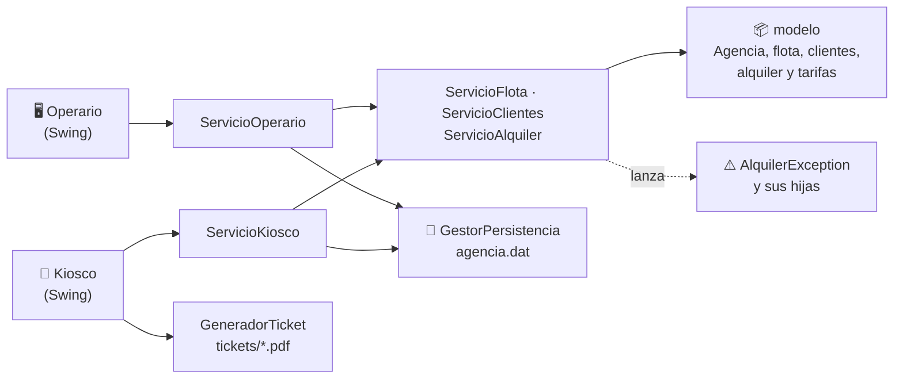
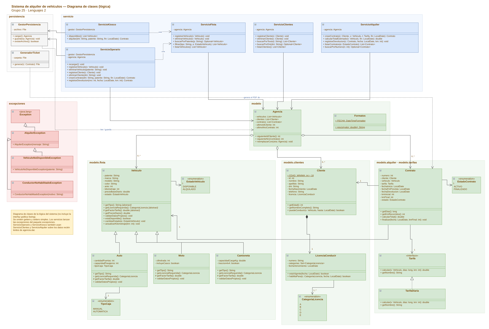

<div align="center">

# 🚗 Agencia de Alquiler de Vehículos

**Aplicación de escritorio para una agencia de alquiler: el operario administra flota, clientes y contratos, y el cliente alquila solo desde un kiosco de autoservicio.**

Proyecto final integrador · Lenguajes 2 · Ingeniería en Informática · Grupo 25


</div>

---

## Contenido

- [Ejecutar el proyecto](#️-ejecutar-el-proyecto)
- [Probar con datos de ejemplo](#-probar-con-datos-de-ejemplo)
- [Correr los tests](#-correr-los-tests)
- [Qué hace cada aplicación](#-qué-hace-cada-aplicación)
- [Arquitectura](#️-arquitectura)
- [Diagrama de clases](#️-diagrama-de-clases)
- [Estructura del proyecto](#-estructura-del-proyecto)
- [Equipo](#-equipo)

---

## ▶️ Ejecutar el proyecto

### Requisitos

| Necesitás | Versión | Cómo comprobarlo |
| --- | --- | --- |
| JDK (Java Development Kit) | 11 o superior | `java -version` y `javac -version` |
| Maven *(opcional)* | 3.6 o superior | `mvn -version` |

> Solo hace falta el JDK para abrir las aplicaciones. Maven se usa para correr los tests.

### 1. Clonar el repositorio

```bash
git clone https://github.com/<tu-usuario>/<nombre-del-repo>.git
cd <nombre-del-repo>
```

### 2. Abrir las aplicaciones

Son dos aplicaciones que trabajan sobre los mismos datos y se pueden tener **abiertas al mismo tiempo**, cada una en su terminal.

<details open>
<summary><b>macOS / Linux: con los scripts (recomendado)</b></summary>

```bash
chmod +x ejecutar.sh ejecutar-kiosco.sh   # solo la primera vez
./ejecutar.sh           # aplicación del operario
./ejecutar-kiosco.sh    # kiosco de autoservicio
```

Cada script compila el código (en `out/` y `out-kiosco/`) y abre su ventana. No necesitan Maven.

</details>

<details>
<summary><b>Windows (PowerShell)</b></summary>

```powershell
javac -encoding UTF-8 -d out (Get-ChildItem -Recurse src\main -Filter *.java).FullName
java -cp out vista.Main          # operario
java -cp out vista.MainKiosco    # kiosco (en otra terminal)
```

Con **Git Bash** también funcionan los scripts `.sh`.

</details>

<details>
<summary><b>Desde IntelliJ IDEA</b></summary>

1. **File → Open** y elegir la carpeta del proyecto (se detecta como proyecto Maven).
2. Ejecutar `src/main/java/vista/Main.java` para el operario y `src/main/java/vista/MainKiosco.java` para el kiosco.

</details>

### 3. ¿Dónde se guardan los datos?

- **`agencia.dat`**: toda la agencia (vehículos, clientes y contratos). Las dos aplicaciones lo guardan apenas se hace un cambio y lo vuelven a leer cada 3 segundos, así cada una ve lo que hizo la otra.
- **`tickets/contrato-N.pdf`**: el ticket que se lleva el cliente al alquilar en el kiosco.
- **`imagenes/<patente>.png`**: la foto de cada vehículo que muestra el kiosco. Si falta, la tarjeta muestra el tipo.

Si `agencia.dat` no existe, las aplicaciones arrancan vacías; si está dañado, avisan y arrancan vacías.

---

## 🧪 Probar con datos de ejemplo

El repositorio trae una agencia cargada con 4 vehículos, 5 clientes y un contrato finalizado. Para usarla, copiala como `agencia.dat` antes de abrir las aplicaciones:

```bash
cp entrega/agencia-demo.dat agencia.dat      # macOS / Linux
Copy-Item entrega\agencia-demo.dat agencia.dat   # Windows
```

> ⚠️ Esto **reemplaza** tu `agencia.dat`. Si tenés datos propios, guardalos antes con otro nombre.

| Vehículo | Tipo | Precio diario |
| --- | --- | --- |
| AB123CD · Fiat Cronos | Auto manual | $30.000 |
| AC456EF · Toyota Corolla | Auto automático | $46.000 |
| A123BCD · Honda CB190 | Moto | $9.000 |
| AD789GH · Toyota Hilux | Camioneta 4x4 | $80.000 |

| Cliente | DNI | Sirve para probar |
| --- | --- | --- |
| Lucía Gómez | 38111222 | Un alquiler aceptado (licencia B vigente) |
| Martín Díaz | 33444555 | Licencias A y B |
| Pedro López | 30777888 | Rechazo por licencia vencida |
| Ana Torres | 40222333 | Rechazo por no tener la categoría B |
| Jorge Paz | 35666777 | Eliminar un cliente |

---

## ✅ Correr los tests

```bash
mvn test
```

Son **245 tests** con JUnit 5 sobre el modelo, los servicios, la persistencia, el ticket y parte de la interfaz.

---

## 📋 Qué hace cada aplicación

### Operario (`./ejecutar.sh`)

| Pestaña | Qué se puede hacer |
| --- | --- |
| **Flota** | Agregar autos, motos y camionetas · filtrar por tipo y estado · dar de baja |
| **Clientes** | Registrar clientes con su licencia · buscar por nombre, apellido o DNI · eliminar |
| **Contratos** | Crear un contrato con total estimado · registrar la devolución · filtrar por estado |

### Kiosco de autoservicio (`./ejecutar-kiosco.sh`)

1. Muestra los vehículos **disponibles** como tarjetas grandes con foto, marca, modelo y precio por día.
2. El cliente toca un vehículo, escribe su **DNI** y la fecha de devolución y ve el total.
3. Al confirmar se crea el contrato y se abre un **ticket en PDF**.

### Reglas del negocio

| Regla | Detalle |
| --- | --- |
| Precio diario | Precio base × factor: Auto 1,0 (automático 1,15) · Moto 0,6 · Camioneta 1,4 (4x4: 1,6) |
| Licencia exigida | Moto → categoría **A** · Auto y Camioneta → categoría **B** |
| Conductor habilitado | 18 años o más, con licencia vigente hasta la fecha de fin del contrato |
| Vehículo | Solo se alquilan vehículos **DISPONIBLES**; al alquilarse pasan a **ALQUILADO** |
| Devolución | Se cobra el mayor entre los días previstos y los reales · el km final no puede ser menor al inicial |
| Datos únicos | No se repiten patentes ni DNI; la numeración de clientes y contratos es correlativa |

---

## 🏗️ Arquitectura

Las dos interfaces Swing no validan reglas: solo muestran lo que devuelven los servicios.



Para que las dos aplicaciones no se pisen, cada cambio **vuelve a leer** `agencia.dat`, aplica el cambio sobre esos datos y **guarda de forma atómica** (escribe un temporal y lo reemplaza).

### Conceptos de POO aplicados

- **Herencia y polimorfismo:** `Auto`, `Moto` y `Camioneta` heredan de `Vehiculo` (abstracta) y cada una define su factor de precio y la licencia que exige.
- **Interfaz (patrón Strategy):** `Contrato` delega el cálculo en una `Tarifa`; una tarifa nueva es otra clase, sin tocar `Contrato`.
- **Composición y agregación:** la `LicenciaConducir` se crea con el `Cliente`; `Agencia` agrupa vehículos, clientes y contratos.
- **Excepciones propias:** checked, para que la interfaz esté obligada a manejarlas y mostrar el mensaje.
- **Serialización:** toda la `Agencia` se guarda y se carga con `ObjectOutputStream` / `ObjectInputStream`.

---

## 🗺️ Diagrama de clases

Diagrama de la lógica del sistema: modelo, servicios, persistencia y excepciones (la interfaz Swing no se incluye).

<p align="center">
  <a href="entrega/Diagrama_Clases_Logica_Grupo25.png">
    
  </a>
</p>

📎 También en [PDF](entrega/Diagrama_Clases_Logica_Grupo25.pdf) y en formato editable de [draw.io](entrega/Diagrama_Clases_Logica_Grupo25.drawio) (se abre en [app.diagrams.net](https://app.diagrams.net) con **Archivo → Abrir desde → Dispositivo**).

---

## 📁 Estructura del proyecto

```text
.
├── ejecutar.sh              # compila y abre la aplicación del operario
├── ejecutar-kiosco.sh       # compila y abre el kiosco
├── pom.xml                  # Java 11 + JUnit 5
├── backlog.md               # historias de usuario
├── imagenes/                # fotos de los vehículos para el kiosco
├── entrega/                 # diagrama de clases, presentación y datos de ejemplo
└── src/
    ├── main/java/
    │   ├── vista/           # las dos interfaces Swing
    │   ├── servicio/        # reglas del negocio y generador de tickets
    │   ├── modelo/          # Agencia + flota, clientes, alquiler, tarifas
    │   ├── persistencia/    # GestorPersistencia
    │   └── excepciones/     # AlquilerException y subclases
    └── test/java/           # 245 tests con JUnit 5
```

---

## 👥 Equipo

**Grupo 25** · Lenguajes 2

| Integrante | Tema en la defensa |
| --- | --- |
| Alejandro Nicolás Salazar | Alcance y arquitectura |
| José Ignacio Soto Llatser | Herencia en la flota |
| Fernando F. Agustín Perez | Clientes y licencias |
| David Maximiliano Juarez Ruiz | Contratos e interfaz Tarifa |
| Samuel David Chaparo | Validaciones y excepciones |
| Tomás Benjamín Montoya | Kiosco, persistencia y ticket |
