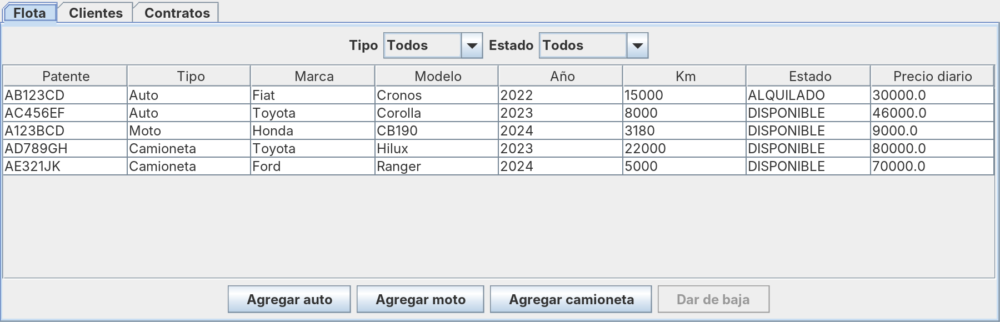
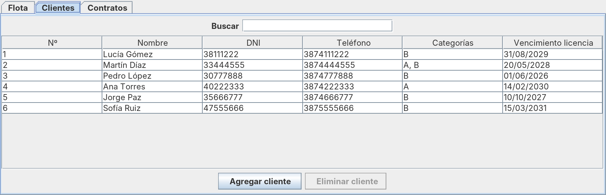
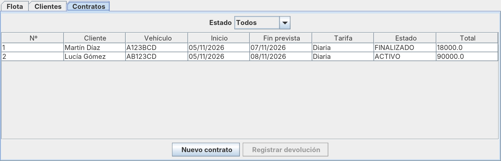
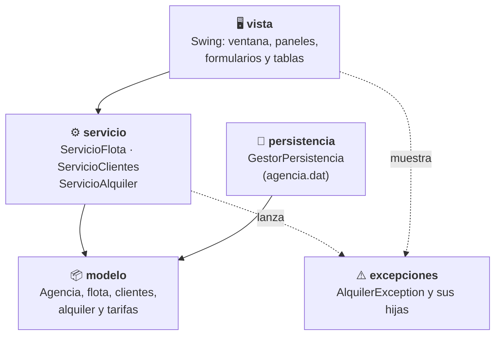
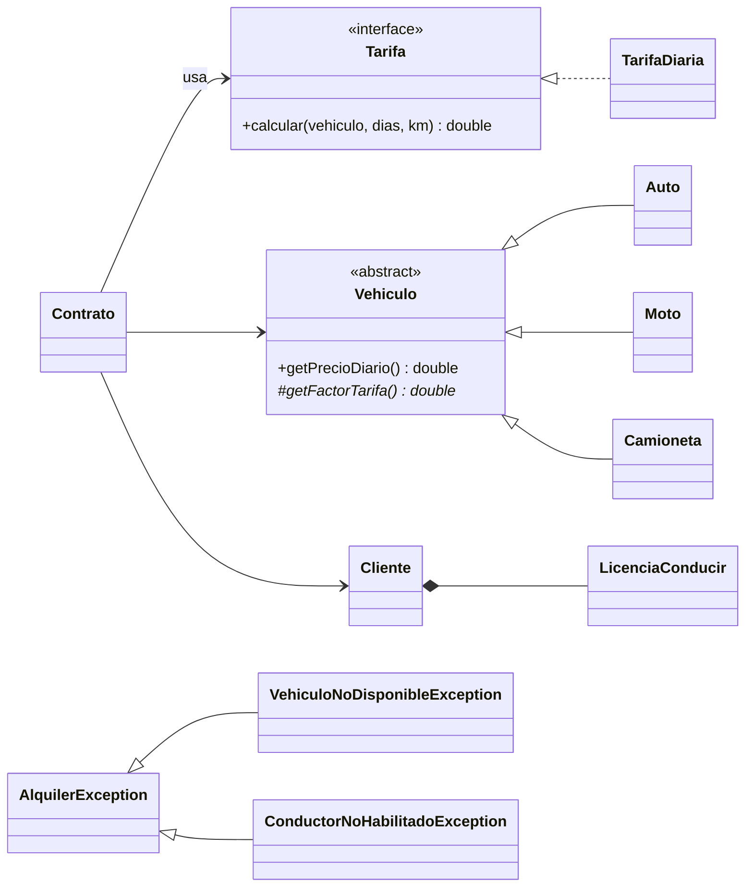

<div align="center">

# 🚗 Agencia de Alquiler de Vehículos

**Aplicación de escritorio para administrar la flota, los clientes y los contratos de una agencia de alquiler.**

Proyecto final integrador · Lenguajes 2 · Ingeniería en Informática · Grupo 25




</div>

---

## Contenido

- [Ejecutar el proyecto](#-ejecutar-el-proyecto)
- [Probar con datos de ejemplo](#-probar-con-datos-de-ejemplo)
- [Correr los tests](#-correr-los-tests)
- [Qué hace la aplicación](#-qué-hace-la-aplicación)
- [Arquitectura](#-arquitectura)
- [Diagrama de clases](#-diagrama-de-clases)
- [Estructura del proyecto](#-estructura-del-proyecto)
- [Equipo](#-equipo)

---

## ▶️ Ejecutar el proyecto

### Requisitos

| Necesitás | Versión | Cómo comprobarlo |
| --- | --- | --- |
| JDK (Java Development Kit) | 11 o superior | `java -version` y `javac -version` |
| Maven *(opcional)* | 3.6 o superior | `mvn -version` |

> Solo hace falta el JDK para abrir la aplicación. Maven se usa para correr los tests.

### 1. Clonar el repositorio

```bash
git clone https://github.com/<tu-usuario>/<nombre-del-repo>.git
cd <nombre-del-repo>
```

### 2. Abrir la aplicación

Elegí la opción que corresponda a tu sistema:

<details open>
<summary><b>macOS / Linux: con el script (recomendado)</b></summary>

```bash
chmod +x ejecutar.sh   # solo la primera vez
./ejecutar.sh
```

El script compila todo el código en la carpeta `out/` y abre la ventana principal. No necesita Maven.

</details>

<details>
<summary><b>Windows (PowerShell)</b></summary>

```powershell
javac -encoding UTF-8 -d out (Get-ChildItem -Recurse src\main -Filter *.java).FullName
java -cp out vista.Main
```

Con **Git Bash** también funciona `./ejecutar.sh`.

</details>

<details>
<summary><b>Con Maven</b></summary>

```bash
mvn compile
java -cp target/classes vista.Main
```

</details>

<details>
<summary><b>Desde IntelliJ IDEA</b></summary>

1. **File → Open** y elegir la carpeta del proyecto (se detecta como proyecto Maven).
2. Abrir `src/main/java/vista/Main.java`.
3. Click en ▶️ junto a `main` → **Run 'Main.main()'**.

</details>

### 3. ¿Dónde se guardan los datos?

Al cerrar la ventana, todo se guarda en **`agencia.dat`**, en la carpeta desde donde se ejecuta la aplicación. La próxima vez que la abras, los datos se cargan solos.

- Si el archivo no existe, la aplicación arranca vacía.
- Si está dañado, avisa con un mensaje y arranca vacía.
- `agencia.dat` está en el `.gitignore`: tus datos no se suben al repositorio.

---

## 🧪 Probar con datos de ejemplo

El repositorio trae una agencia cargada con 4 vehículos, 5 clientes y un contrato finalizado. Para usarla, copiala como `agencia.dat` antes de abrir la aplicación:

```bash
# macOS / Linux
cp entrega/agencia-demo.dat agencia.dat
./ejecutar.sh
```

```powershell
# Windows
Copy-Item entrega\agencia-demo.dat agencia.dat
java -cp out vista.Main
```

> ⚠️ Esto **reemplaza** tu `agencia.dat`. Si tenés datos propios, guardalos antes con otro nombre.

| Vehículo | Tipo | Precio diario |
| --- | --- | --- |
| AB123CD · Fiat Cronos | Auto manual | $30.000 |
| AC456EF · Toyota Corolla | Auto automático | $46.000 |
| A123BCD · Honda CB190 | Moto | $9.000 |
| AD789GH · Toyota Hilux | Camioneta 4x4 | $80.000 |

Los clientes cubren los casos de prueba: Lucía Gómez (licencia B vigente), Martín Díaz (A y B), Pedro López (licencia vencida), Ana Torres (solo A) y Jorge Paz.

---

## ✅ Correr los tests

```bash
mvn test
```

Son **170 tests** con JUnit 5 que cubren el modelo, los servicios, la persistencia y los modelos de tabla de la vista.

---

## 📋 Qué hace la aplicación

La ventana tiene tres pestañas:

| Pestaña | Qué se puede hacer |
| --- | --- |
| **Flota** | Agregar autos, motos y camionetas · filtrar por tipo y estado · dar de baja un vehículo |
| **Clientes** | Registrar clientes con su licencia · buscar por nombre, apellido o DNI · eliminar clientes sin contratos activos |
| **Contratos** | Crear un contrato con total estimado · registrar la devolución · filtrar por estado |





### Reglas del negocio

| Regla | Detalle |
| --- | --- |
| Precio diario | Precio base × factor del tipo: Auto 1,0 (automático 1,15) · Moto 0,6 · Camioneta 1,4 (4x4: 1,6) |
| Licencia exigida | Moto → categoría **A** · Auto y Camioneta → categoría **B** |
| Conductor habilitado | 18 años o más, con licencia vigente hasta la fecha de fin del contrato |
| Vehículo | Solo se alquilan vehículos **DISPONIBLES**; al alquilarse pasan a **ALQUILADO** |
| Devolución | Se cobra el mayor entre los días previstos y los reales · el km final no puede ser menor al inicial |
| Datos únicos | No se repiten patentes ni DNI; la numeración de clientes y contratos es correlativa |

---

## 🏗️ Arquitectura

El código está separado en capas: la interfaz nunca valida reglas, solo muestra lo que devuelven los servicios.



### Conceptos de POO aplicados



- **Herencia y polimorfismo:** cada tipo de vehículo define su factor de precio y la licencia que exige.
- **Interfaz (patrón Strategy):** `Contrato` delega el cálculo en una `Tarifa`; una tarifa nueva es otra clase, sin tocar `Contrato`.
- **Composición:** la `LicenciaConducir` se crea con el `Cliente` y no existe sin él.
- **Excepciones propias:** checked, para que la interfaz esté obligada a manejarlas y mostrar el mensaje.
- **Serialización:** toda la `Agencia` se guarda y se carga con `ObjectOutputStream` / `ObjectInputStream`.

---

## 🗺️ Diagrama de clases

Diagrama UML completo (vista, servicios, persistencia y modelo):

<p align="center">
  <a href="entrega/Diagrama%20de%20Clases%20UML%20Alquiler%20dd%20vehiculos.drawio.svg">
    
  </a>
</p>

📎 Otros formatos en [`entrega/`](entrega/): [PDF](entrega/Diagrama%20de%20Clases%20UML%20Alquiler%20de%20vehiculos.drawio.pdf) · [PNG](entrega/Diagrama_Clases_UML_Grupo25.png) · [draw.io editable](entrega/Diagrama_Clases_UML_Grupo25.drawio) · [versión en texto (Mermaid)](uml.md)

---

## 📁 Estructura del proyecto

```text
.
├── ejecutar.sh              # compila y abre la app sin Maven
├── pom.xml                  # Java 11 + JUnit 5
├── uml.md                   # diagrama de clases en texto (Mermaid)
├── backlog.md               # historias de usuario
├── docs/                    # capturas para este README
├── entrega/                 # diagramas UML y datos de ejemplo
└── src/
    ├── main/java/
    │   ├── vista/           # Main, VentanaPrincipal, paneles, formularios, modelos de tabla
    │   ├── servicio/        # reglas del negocio
    │   ├── modelo/          # Agencia + flota, clientes, alquiler, tarifas
    │   ├── persistencia/    # GestorPersistencia
    │   └── excepciones/     # AlquilerException y subclases
    └── test/java/           # 170 tests con JUnit 5
```

---

## 👥 Equipo

**Grupo 25** · Lenguajes 2

| Integrante | Tema en la defensa |
| --- | --- |
| Alejandro Nicolás Salazar | Alcance y arquitectura |
| José Ignacio Soto Llatser | Herencia en la flota |
| Fernando F. Agustín Perez | Clientes y licencias |
| David Maximiliano Juarez Ruiz | Contratos e interfaz Tarifa |
| Samuel David Chaparo | Validaciones y excepciones |
| Tomás Benjamín Montoya | Interfaz Swing y persistencia |
