# Diagrama de clases UML — Agencia de alquiler de vehículos

Fuente de verdad del diseño, en texto. Los nombres de clases, atributos y métodos del código deben coincidir con este archivo. Si el diseño cambia durante una historia, actualizar este archivo en el mismo paso.

## Regla de nombres

- Todo nombre de clase, atributo, método o parámetro del modelo y los servicios se escribe **exactamente** como figura en este archivo.
- Lo mismo vale para la vista cuando el dato es el mismo: un campo de formulario o un getter que representa un atributo del modelo usa el nombre de ese atributo (por ejemplo `precioBaseDiario` y `getPrecioBaseDiario()`, no `precioBase`).
- Si hace falta un nombre que no está acá, primero se agrega a este archivo y después se usa en el código.
- Antes de dar por terminada una historia, comparar los nombres del código con este archivo y actualizar el diagrama, la tabla de estado y las notas.

Notación (Mermaid): `-` privado, `+` público, `#` protegido, `*` abstracto, `$` static. `<|--` herencia, `<|..` implementa, `*--` composición, `o--` agregación, `-->` asociación, `..>` dependencia.

Última actualización: historia #5 terminada (dar de baja un vehículo).

## Diagrama

```mermaid
classDiagram
    direction TB

    namespace vista {
        class Main {
            +main(args: String[])$ void
        }
        class VentanaPrincipal {
            -comboTipo: JComboBox~String~
            -comboEstado: JComboBox~String~
            -tablaFlota: JTable
            -darDeBaja: JButton
            -tablaClientes: JTable
            -agregarCliente: JButton
            +VentanaPrincipal(servicioFlota: ServicioFlota, servicioClientes: ServicioClientes)
        }
        class FormularioAuto {
            -servicio: ServicioFlota
            -alRegistrar: Runnable
            +FormularioAuto(padre: Frame, servicio: ServicioFlota, alRegistrar: Runnable)
            -guardar() void
        }
        class FormularioMoto {
            -servicio: ServicioFlota
            -alRegistrar: Runnable
            +FormularioMoto(padre: Frame, servicio: ServicioFlota, alRegistrar: Runnable)
            -guardar() void
        }
        class FormularioCamioneta {
            -servicio: ServicioFlota
            -alRegistrar: Runnable
            -capacidadCargaKg: JTextField
            -traccion4x4: JCheckBox
            +FormularioCamioneta(padre: Frame, servicio: ServicioFlota, alRegistrar: Runnable)
            -guardar() void
        }
        class FormularioCliente {
            -servicio: ServicioClientes
            -alRegistrar: Runnable
            +FormularioCliente(padre: Frame, servicio: ServicioClientes, alRegistrar: Runnable)
            -guardar() void
            ~fecha(etiqueta: String, campo: JTextField)$ LocalDate
        }
        class PanelDatosVehiculo {
            -patente: JTextField
            -marca: JTextField
            -modelo: JTextField
            -color: JTextField
            -anio: JTextField
            -kilometraje: JTextField
            -precioBaseDiario: JTextField
            +agregar(etiqueta: String, campo: Component) void
            +getPatente() String
            +getMarca() String
            +getModelo() String
            +getColor() String
            +getAnio() int
            +getKilometraje() int
            +getPrecioBaseDiario() double
            ~entero(etiqueta: String, campo: JTextField)$ int
            ~decimal(etiqueta: String, campo: JTextField)$ double
        }
        class ModeloTablaFlota {
            -COLUMNAS: String[]$
            -servicio: ServicioFlota
            -filtroTipo: String
            -filtroEstado: EstadoVehiculo
            +setFiltro(tipo: String, estado: EstadoVehiculo) void
            +getVehiculoEn(fila: int) Vehiculo
            +getRowCount() int
            +getColumnCount() int
            +getColumnName(columna: int) String
            +getValueAt(fila: int, columna: int) Object
        }
        class ModeloTablaClientes {
            -COLUMNAS: String[]$
            -FORMATO_FECHA: DateTimeFormatter$
            -servicio: ServicioClientes
            +getRowCount() int
            +getColumnCount() int
            +getColumnName(columna: int) String
            +getValueAt(fila: int, columna: int) Object
        }
    }

    namespace servicio {
        class ServicioFlota {
            -agencia: Agencia
            +registrarVehiculo(v: Vehiculo) void
            +listarVehiculos() List~Vehiculo~
            +eliminarVehiculo(v: Vehiculo) void
            +filtrar(tipo: String, estado: EstadoVehiculo) List~Vehiculo~
        }
        class ServicioClientes {
            -agencia: Agencia
            +registrarCliente(c: Cliente) void
            -exigir(valor: String, campo: String) void
            +eliminarCliente(c: Cliente) void
            +buscarPorTexto(texto: String) List~Cliente~
            +listarClientes() List~Cliente~
        }
        class ServicioAlquiler {
            -agencia: Agencia
            +crearContrato(c: Cliente, v: Vehiculo, t: Tarifa, fin: LocalDate) Contrato
            +registrarDevolucion(c: Contrato, fecha: LocalDate, kmFinal: int) void
            +listarContratos(estado: EstadoContrato) List~Contrato~
        }
    }

    namespace persistencia {
        class GestorPersistencia {
            -archivo: File
            +guardar(a: Agencia) void
            +cargar() Agencia
            +existeArchivo() boolean
        }
    }

    namespace modelo {
        class Agencia {
            -vehiculos: List~Vehiculo~
            -clientes: List~Cliente~
            -contratos: List~Contrato~
            -ultimoIdCliente: int
            -ultimoNroContrato: int
            +getVehiculos() List~Vehiculo~
            +getClientes() List~Cliente~
            +siguienteIdCliente() int
            +siguienteNroContrato() int
        }
    }

    namespace flota {
        class Vehiculo {
            <<abstract>>
            -patente: String
            -marca: String
            -modelo: String
            -color: String
            -anio: int
            -kilometraje: int
            -precioBaseDiario: double
            -estado: EstadoVehiculo
            +getTipo()* String
            #getFactorTarifa()* double
            +getPrecioDiario() double
            +validarDatosPropios() void
            +getLicenciaRequerida()* CategoriaLicencia
            +estaDisponible() boolean
            +cambiarEstado(e: EstadoVehiculo) void
            +actualizarKilometraje(km: int) void
        }
        class Auto {
            -cantidadPuertas: int
            -capacidadPasajeros: int
            -tipoCaja: TipoCaja
            +getTipo() String
            #getFactorTarifa() double
            +validarDatosPropios() void
            +getLicenciaRequerida() CategoriaLicencia
        }
        class Moto {
            -cilindrada: int
            -incluyeCasco: boolean
            +getTipo() String
            #getFactorTarifa() double
            +validarDatosPropios() void
            +getLicenciaRequerida() CategoriaLicencia
        }
        class Camioneta {
            -capacidadCargaKg: double
            -traccion4x4: boolean
            +getTipo() String
            #getFactorTarifa() double
            +validarDatosPropios() void
            +getLicenciaRequerida() CategoriaLicencia
        }
        class EstadoVehiculo {
            <<enumeration>>
            DISPONIBLE
            ALQUILADO
        }
        class TipoCaja {
            <<enumeration>>
            MANUAL
            AUTOMATICA
        }
    }

    namespace clientes {
        class Cliente {
            -id: int
            -nombre: String
            -apellido: String
            -dni: String
            -fechaNacimiento: LocalDate
            -telefono: String
            -licencia: LicenciaConducir
            +EDAD_MINIMA: int = 18$
            +setId(id: int) void
            +getNombreCompleto() String
            +getEdad() int
            +puedeConducir(v: Vehiculo, hasta: LocalDate) boolean
        }
        class LicenciaConducir {
            -numero: String
            -categorias: Set~CategoriaLicencia~
            -fechaVencimiento: LocalDate
            +estaVigente(fecha: LocalDate) boolean
            +habilitaPara(c: CategoriaLicencia, fecha: LocalDate) boolean
        }
        class CategoriaLicencia {
            <<enumeration>>
            A
            B
            C
            D
            E
        }
    }

    namespace alquiler {
        class Contrato {
            -numero: int
            -cliente: Cliente
            -vehiculo: Vehiculo
            -tarifa: Tarifa
            -fechaInicio: LocalDate
            -fechaFinPrevista: LocalDate
            -fechaDevolucion: LocalDate
            -kmInicial: int
            -kmFinal: int
            -estado: EstadoContrato
            +RECARGO_ATRASO: double = 1.5$
            +getDias() long
            +getDiasAtraso() long
            +getKmRecorridos() int
            +calcularCostoAlquiler() double
            +calcularRecargoAtraso() double
            +calcularTotal() double
            +finalizar(fecha: LocalDate, kmFinal: int) void
            +estaVencido(hoy: LocalDate) boolean
        }
        class EstadoContrato {
            <<enumeration>>
            ACTIVO
            FINALIZADO
        }
    }

    namespace tarifas {
        class Tarifa {
            <<interface>>
            +calcular(v: Vehiculo, dias: long, km: int) double
            +getNombre() String
        }
        class TarifaDiaria {
            +calcular(v: Vehiculo, dias: long, km: int) double
            +getNombre() String
        }
        class TarifaSemanal {
            -porcentajeDescuento: double
            +calcular(v: Vehiculo, dias: long, km: int) double
            +getNombre() String
        }
        class TarifaKilometraje {
            -kmLibresPorDia: int
            -precioKmExcedente: double
            -porcentajeDescuento: double
            +calcular(v: Vehiculo, dias: long, km: int) double
            +getNombre() String
        }
    }

    namespace excepciones {
        class AlquilerException {
            +AlquilerException(mensaje: String)
        }
        class VehiculoNoDisponibleException
        class ConductorNoHabilitadoException
    }

    Vehiculo <|-- Auto
    Vehiculo <|-- Moto
    Vehiculo <|-- Camioneta
    Vehiculo --> "1" EstadoVehiculo
    Auto --> "1" TipoCaja

    Cliente "1" *-- "1" LicenciaConducir
    LicenciaConducir --> "1..*" CategoriaLicencia

    Contrato "0..*" --> "1" Cliente : cliente
    Contrato "0..*" --> "1" Vehiculo : vehiculo
    Contrato "0..*" --> "1" Tarifa : tarifa
    Contrato --> "1" EstadoContrato

    Tarifa <|.. TarifaDiaria
    Tarifa <|.. TarifaSemanal
    Tarifa <|.. TarifaKilometraje

    Agencia "1" o-- "0..*" Vehiculo
    Agencia "1" o-- "0..*" Cliente
    Agencia "1" o-- "0..*" Contrato

    ServicioFlota --> "1" Agencia
    ServicioClientes --> "1" Agencia
    ServicioAlquiler --> "1" Agencia
    GestorPersistencia ..> Agencia : serializa

    Exception <|-- AlquilerException
    AlquilerException <|-- VehiculoNoDisponibleException
    AlquilerException <|-- ConductorNoHabilitadoException

    Main ..> VentanaPrincipal : crea
    VentanaPrincipal ..> FormularioAuto : abre
    VentanaPrincipal ..> FormularioMoto : abre
    VentanaPrincipal ..> FormularioCamioneta : abre
    VentanaPrincipal ..> FormularioCliente : abre
    VentanaPrincipal --> ModeloTablaClientes
    VentanaPrincipal --> ModeloTablaFlota
    FormularioAuto --> ServicioFlota
    FormularioMoto --> ServicioFlota
    FormularioCamioneta --> ServicioFlota
    FormularioCliente --> ServicioClientes
    FormularioAuto *-- PanelDatosVehiculo
    FormularioMoto *-- PanelDatosVehiculo
    FormularioCamioneta *-- PanelDatosVehiculo
    ModeloTablaFlota --> ServicioFlota
    ModeloTablaClientes --> ServicioClientes
```

## Estado de implementación

| Clase | Paquete | Estado | Pendiente | Historia |
| --- | --- | --- | --- | --- |
| `Vehiculo` | `modelo.flota` | Parcial | `getLicenciaRequerida()`, `estaDisponible()`, `actualizarKilometraje()` | #9, #10, #11 |
| `Auto` | `modelo.flota` | Parcial | `getLicenciaRequerida()` | #10 |
| `EstadoVehiculo`, `TipoCaja` | `modelo.flota` | Hecho | — | #1 |
| `Moto` | `modelo.flota` | Parcial | `getLicenciaRequerida()` | #10 |
| `Camioneta` | `modelo.flota` | Parcial | `getLicenciaRequerida()` | #10 |
| `Agencia` | `modelo` | Parcial | `clientes`, `contratos`, contadores y sus métodos | #6, #9 |
| `ServicioFlota` | `servicio` | Hecho | — | #1, #4, #5 |
| `AlquilerException` | `excepciones` | Hecho | — | #1 |
| `Main`, `VentanaPrincipal`, `FormularioAuto`, `FormularioMoto`, `FormularioCamioneta`, `PanelDatosVehiculo`, `ModeloTablaFlota` | `vista` | Hecho para #5 | Crecen con cada historia | #1, #2, #3, #4, #5 |
| `Cliente`, `LicenciaConducir`, `CategoriaLicencia`, `ServicioClientes` | `modelo.clientes`, `servicio` | Pendiente | Todo | #6, #7, #8 |
| `Contrato`, `EstadoContrato`, `ServicioAlquiler` | `modelo.alquiler`, `servicio` | Pendiente | Todo | #9, #11, #12, #15 |
| `Tarifa`, `TarifaDiaria`, `TarifaSemanal`, `TarifaKilometraje` | `modelo.tarifas` | Pendiente | Todo | #9, #13, #14 |
| `VehiculoNoDisponibleException`, `ConductorNoHabilitadoException` | `excepciones` | Pendiente | Todo | #9, #10 |
| `GestorPersistencia` | `persistencia` | Pendiente | Todo | #16 |

## Notas de diseño

- Las clases del modelo tienen getters públicos para los atributos que muestra la interfaz (`getPatente()`, `getMarca()`, `getModelo()`, `getAnio()`, `getKilometraje()`, `getPrecioBaseDiario()`, `getEstado()`). No se dibujan en el diagrama para no saturarlo.
- `validarDatosPropios()` valida los datos propios de cada subclase y la llama `ServicioFlota.registrarVehiculo()`. En `Vehiculo` no valida nada; `Auto` exige puertas y pasajeros mayores a 0; `Moto` exige cilindrada mayor a 0; `Camioneta` exige capacidad de carga mayor a 0.
- `PanelDatosVehiculo` tiene los 7 campos comunes del formulario. Cada formulario de vehículo lo contiene y le agrega sus campos propios con `agregar()`.
- `ServicioFlota.registrarVehiculo()` rechaza con `AlquilerException`: patente vacía o en blanco, kilometraje o precio negativos y patente repetida (sin distinguir mayúsculas).
- `ServicioFlota.filtrar(tipo, estado)` devuelve los vehículos que cumplen todos los filtros pedidos, en el orden en que se registraron. `tipo` es el texto de `getTipo()` ("Auto", "Moto", "Camioneta") y `null` en `tipo` o en `estado` significa sin filtro.
- `ModeloTablaFlota` guarda el filtro (`filtroTipo`, `filtroEstado`) y lo cambia con `setFiltro()`, que refresca la tabla. Siempre consulta a `ServicioFlota.filtrar()`, por eso un vehículo nuevo aparece solo si cumple el filtro elegido.
- `VentanaPrincipal` tiene dos listas desplegables, `comboTipo` y `comboEstado`, con "Todos" como primera opción; "Todos" se traduce a `null` antes de llamar a `setFiltro()`.
- `ServicioFlota.eliminarVehiculo(v)` quita el vehículo de la flota y lanza `AlquilerException` ("No se puede dar de baja un vehículo alquilado") si `v.getEstado()` es `ALQUILADO`. No distingue si `v` estaba en la flota: la interfaz solo ofrece vehículos de la tabla.
- `ModeloTablaFlota.getVehiculoEn(fila)` devuelve el vehículo de esa fila según el filtro elegido.
- En `VentanaPrincipal`, el botón `darDeBaja` está habilitado solo con una fila elegida en `tablaFlota`. Pide confirmación mostrando la patente; si se confirma, llama a `eliminarVehiculo()` y refresca la tabla conservando el filtro, y si hay error lo muestra en un cuadro de diálogo.
- `Vehiculo.cambiarEstado()` asigna el estado sin validar nada. Las reglas de cuándo se puede alquilar o devolver llegan con #9 y #11.
- `getFactorTarifa()` es protegido: solo lo usa `getPrecioDiario()`. `Camioneta` devuelve 1,4, o 1,6 si tiene tracción 4x4.
- El punto de entrada (`Main`) está en el paquete `vista`.
